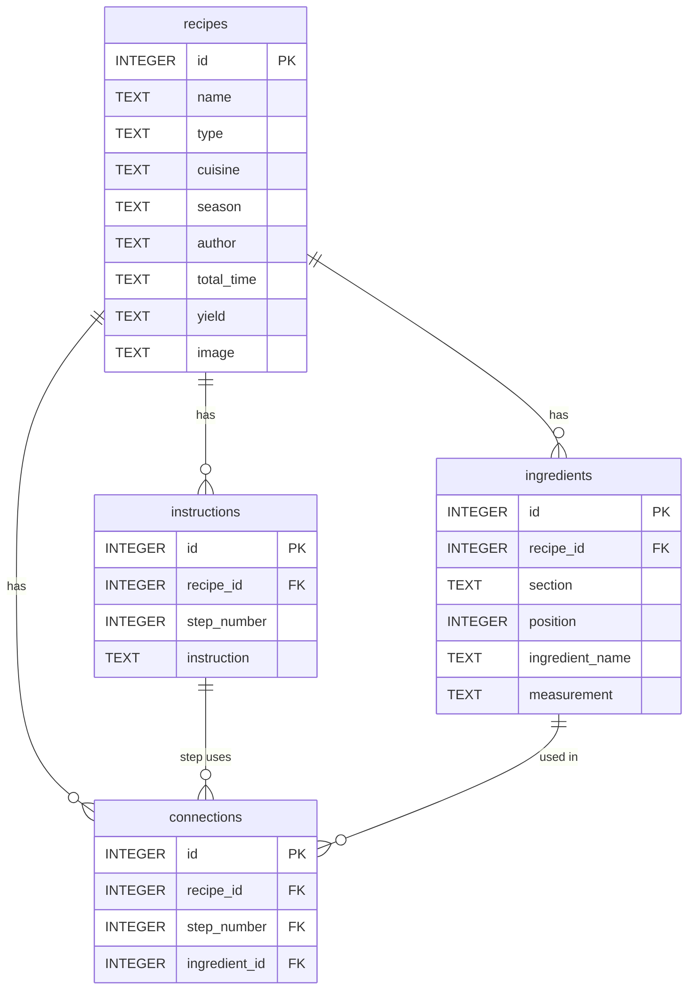

# The Recipe Box

A personal recipe website built with Flask and SQLite. Add, import, browse, search, filter, edit and delete your own recipes, with photos, ingredients grouped into sections, step-by-step instructions and seasonal picks.

## Features

- **Add and edit recipes** with name, type, cuisine, season, author, total time, yield, photo, ingredients and instructions. Ingredients can be grouped under section headings such as "Crust" or "Topping".
- **Import from a link.** Paste a recipe URL and the app reads the page's schema.org Recipe data (JSON-LD), converts ISO 8601 durations like `PT1H15M` into readable times, and splits each ingredient line into a measurement and a name. Ingredient sections are kept for Tasty Recipes, WP Recipe Maker and Mediavine Create recipe cards.
- **Categories:** Breakfast, Lunch, Dinner, Dessert and Sides, each with its own page.
- **Search** by name, type or cuisine, and **filter** by cuisine or season from the side menu.
- **Home page** with a "Latest Recipes" grid and a seasonal favorites section that follows the current month.
- **Recipe page** with a checklist-style ingredient list, numbered steps and a print-friendly layout.
- **Delete with confirmation.** A popup asks before deleting; the recipe's rows and its photo file are removed, and you land back on the home page.

## Tech stack

- Backend: Python, Flask
- Database: SQLite (`sqlite3` from the standard library, raw SQL, no ORM)
- Scraping: requests, Beautiful Soup
- Frontend: Jinja templates, HTML, CSS, JavaScript, Bootstrap 5

## Data model

Four tables in `recipedatabase.db`, created in `Main_DataBase.py`. Foreign keys are switched on for every connection (`PRAGMA foreign_keys = ON`), and every child table uses `ON DELETE CASCADE`, so deleting a recipe removes its ingredients, instructions and connections in one statement.



| Table | Grain | Keys and constraints |
| --- | --- | --- |
| `recipes` | one row per recipe | `UNIQUE (name, type, cuisine)`; `image` is the path to the photo in `static/images` |
| `ingredients` | one row per ingredient line | `recipe_id` → `recipes.id`; `section` is an optional heading (NULL when the recipe has none); `position` keeps the list in the order it was entered |
| `instructions` | one row per step | `UNIQUE (recipe_id, step_number)` |
| `connections` | one row per ingredient used in a step | composite FK `(recipe_id, step_number)` → `instructions`, and `ingredient_id` → `ingredients.id` |

Design notes:

- The same ingredient can appear more than once in a recipe (brown sugar in both the batter and the topping), so `ingredients` has no uniqueness rule on the name, and `connections` points at an ingredient by its `id` rather than its name.
- `connections` is in the schema and used by `Data.py`, but the Add/Edit forms don't fill it in yet.
- **Migrations:** `upgrade_schema()` in `Main_DataBase.py` runs every time the app starts and is safe to repeat. It brings a database from before ingredient sections up to date. Because SQLite can't drop a UNIQUE constraint in place, it builds new tables, copies the rows across (using `ROW_NUMBER() OVER (PARTITION BY recipe_id ORDER BY id)` to fill `position`, and a join on name to turn `connections.ingredient_name` into `ingredient_id`), then swaps them in, all in one transaction.

## Running it locally

```bash
python -m venv venv
source venv/bin/activate        # Windows: venv\Scripts\activate
pip install flask requests beautifulsoup4
python test.py
```

Then open http://127.0.0.1:5000. The repo includes `recipedatabase.db` with a few sample recipes; if the file is missing, run `python Data.py` to create the tables and add a test recipe.

## Project layout

| Path | What it is |
| --- | --- |
| `test.py` | The Flask app: routes, form handling and the recipe importer |
| `Main_DataBase.py` | Table definitions, `upgrade_schema()` and a small `Database` helper class |
| `Data.py` | Script that adds a sample recipe through the `Database` class |
| `clear_database.py` | Empties all four tables (edit `DATABASE_PATH` first) |
| `templates/` | Jinja templates for the pages, header, side menu and the shared Add/Edit form |
| `static/css/styles.css` | Site styles, including the print layout |
| `static/js/recipe-form.js` | Adds, reorders and removes ingredient, section and step rows on the form |
| `static/images/` | Uploaded recipe photos |

## Routes

| Route | Method | Purpose |
| --- | --- | --- |
| `/` | GET | Home page |
| `/all-recipes` | GET | All recipes, with `search`, `cuisine` and `season` query filters |
| `/<category>` | GET | One category, such as `/dessert` |
| `/all-recipes/<id>` | GET | Recipe details |
| `/add` | GET | Add recipe form |
| `/import-recipe` | GET, POST | Fill the add form from a recipe URL |
| `/submit` | POST | Save a new recipe |
| `/modify-recipe/<id>` | GET, POST | Edit a recipe |
| `/delete_recipe/<id>` | POST | Delete a recipe and its photo |
